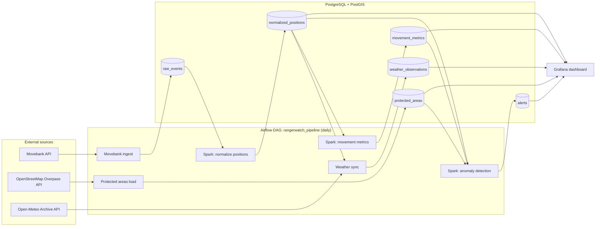

# RangerWatch

A daily data pipeline that turns wildlife GPS tracking data into alerts and a dashboard, so unusual animal behaviour is easy to spot.

## What and why

GPS tags report an animal's position every so often, and on its own that is just a long list of coordinates. RangerWatch takes public tracking data from [Movebank](https://www.movebank.org/), adds weather and protected-area boundaries, measures movement, and raises alerts for the patterns conservation teams care about: an animal that stops moving (injury or tag failure), leaves a protected area, jumps an unusually long distance, or stops reporting.

| Alert | Rule |
|---|---|
| `HIGH_MOVEMENT` | More than 50 km between observations |
| `NO_MOVEMENT` | Less than 0.5 km between observations |
| `PROLONGED_STATIONARY` | Stationary for more than 24 hours |
| `MISSING_TELEMETRY` | Gap of more than 24 hours between fixes |
| `LEFT_PROTECTED_AREA` | Position moves from inside to outside a protected area |

## Architecture



The inside/outside check runs in PostGIS (`ST_Intersects`); Spark detects the moment an animal leaves the park.

## Dashboard


## Tech stack

Airflow, Spark (standalone cluster), PostgreSQL + PostGIS, Python, Grafana, Docker Compose.

## Getting started

1. Create a `.env` file (do not commit it):

   ```
   POSTGRES_DB=rangerwatch
   POSTGRES_USER=<user>
   POSTGRES_PASSWORD=<password>
   AIRFLOW_UID=50000
   GRAFANA_ADMIN_PASSWORD=<password>
   ```

2. Start the stack (the first build takes a few minutes):

   ```
   docker compose up -d --build
   ```

3. Run the PostGIS setup SQL in `database/` (enables PostGIS and creates the reference tables).
4. Open Airflow at <http://localhost:8080> (user `admin`, password from `docker exec rw-airflow cat /opt/airflow/standalone_admin_password.txt`), then unpause and trigger `rangerwatch_pipeline`.
5. Open Grafana at <http://localhost:3000>, import `grafana/dashboards/rangerwatch.json`, and set the time range to your data's dates.

## Data and attribution

Tracking data: Movebank (study 2911040; check the study's terms before reuse). Weather: [Open-Meteo](https://open-meteo.com/) (CC BY 4.0). Boundaries: © [OpenStreetMap](https://www.openstreetmap.org/copyright) contributors (ODbL).

## Limitations

- Weather uses one average position per animal per day, which is coarse for animals that travel far.
- Protected areas come from OpenStreetMap, not official sources, and marine reserves are not included.
- The `alerts` table is rebuilt on every run, so there is no alert history.
