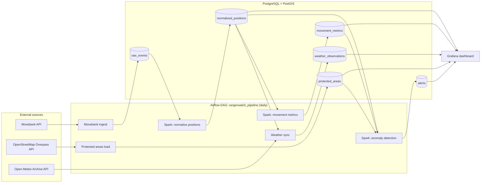

## Architecture

Spark jobs run on a standalone Spark cluster (master + worker) and are submitted from Airflow.
The protected-area check runs in PostGIS (`ST_Intersects`); Spark detects the inside-to-outside transition.
